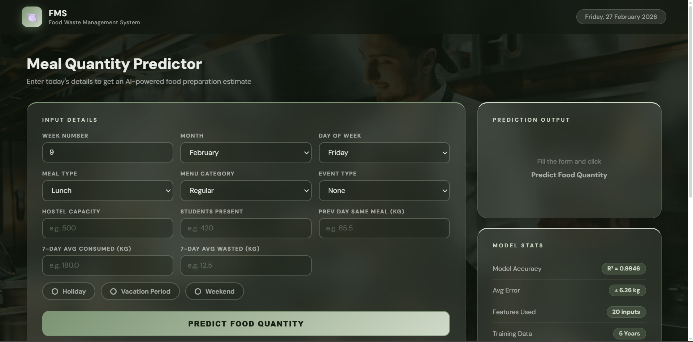
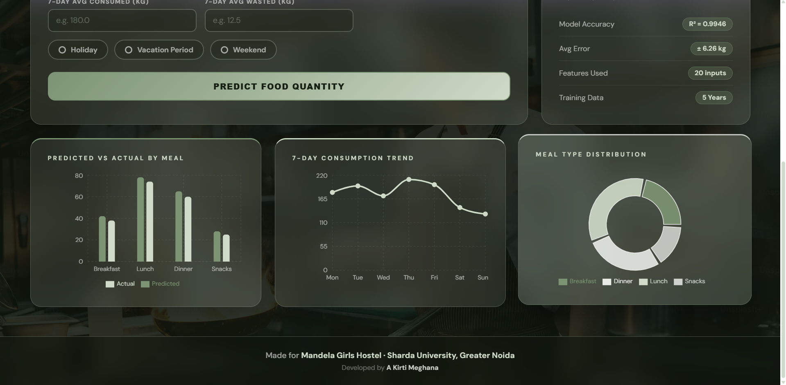

# Food Waste Management System

## Live Project

 https://food-waste-management-system-py.vercel.app/

## Screenshots

---

## About the Project

I developed a **Food Waste Management System for my own Hostel Mess**, with the aim of solving a real-world problem using Machine Learning, Data Science, and Full-Stack Development.

The inspiration came from observing the amount of food wasted in hostel messes every day. I wanted to build something practical that could help mess management make better food preparation decisions.

With this tool, food wastage could potentially drop from approximately **45–50 kg to 4–8 kg per day** through more informed food preparation decisions.

Things get much more exciting when we put our technical skills into actual use!

## Project Development

### Stage 1: Data Collection

I collected historical hostel attendance and meal records spanning five years, excluding the COVID-affected years.

The raw dataset included:

- Date
- Total hostel strength
- Students present
- Students absent
- Food wasted (in kg)

Some unavailable records were handled using reasonable assumptions during data preparation.

### Stage 2: Data Cleaning and Feature Engineering

I used the academic calendars of the respective years to derive contextual features such as holidays, college events, and vacation periods.

I also extracted several other features, including:

- Week number, month, and day of the week
- Weekend, holiday, vacation, and event indicators
- Previous day's same-meal consumption
- Last 7 days' average consumption
- Last 7 days' average food wastage
- Encoded menu categories and one-hot encoded meal types

This resulted in 20 meaningful input features for the machine learning model.

### Stage 3: Exploratory Data Analysis

Exploratory Data Analysis (EDA) was performed to understand the distribution of key variables, identify patterns in food wastage, and validate the dataset before proceeding to model development.

Some of the key analyses included:

- Food Waste by Meal Type
- Student Attendance vs. Food Consumption
- Holiday Impact
- Monthly Food Waste Trends
- Correlation Analysis

### Stage 4: Machine Learning Model Development

I trained a **Gradient Boosting Regressor** on the prepared dataset.

The model achieved the following results:

| Evaluation Metric | Result |
|---|---:|
| R² Score | 0.9946 |
| Mean Absolute Error | 6.26 kg |
| Overall Model Accuracy | 96.27% |

The trained model was saved and integrated into the application to generate food preparation predictions.

### Stage 5: Full-Stack Development

I developed the application using a Python full-stack architecture.

**Frontend:**
- React.js
- JavaScript
- HTML5
- CSS3
- Recharts for data visualization

**Backend:**
- Python
- FastAPI
- RESTful APIs
- Pydantic

**Database:**
- MongoDB Atlas
- PyMongo

**Machine Learning:**
- Scikit-learn
- Gradient Boosting Regressor
- NumPy
- Joblib

The frontend communicates with the FastAPI backend through REST APIs. The backend processes prediction requests using the trained machine learning model and stores prediction records in MongoDB Atlas.

The dashboard retrieves live statistics, prediction history, and chart data from the backend.

### Stage 6: Deployment

The application is deployed using:

- **Frontend:** Vercel
- **Backend:** Render
- **Database:** MongoDB Atlas

The frontend and backend are independently deployed and communicate through API requests.

## Key Features

- Machine Learning-based food preparation predictions
- Interactive dashboard with live statistics
- Prediction history stored in MongoDB Atlas
- Dynamic charts and data visualizations
- REST API integration
- Deployed full-stack application

## API Endpoints

| Method | Endpoint | Description |
|---|---|---|
| GET | `/health` | Backend health check |
| POST | `/api/predict` | Generate food waste prediction |
| GET | `/api/history` | Retrieve saved predictions |
| GET | `/api/dashboard-stats` | Retrieve dashboard statistics |

## Future Scope

- Integration with live hostel attendance systems
- Continuous model evaluation using newly collected data
- Improved predictions using additional contextual features
- Expansion to multiple hostel messes and institutional kitchens

---

**Built with Python, React, Machine Learning, and a goal of reducing everyday food wastage.**
